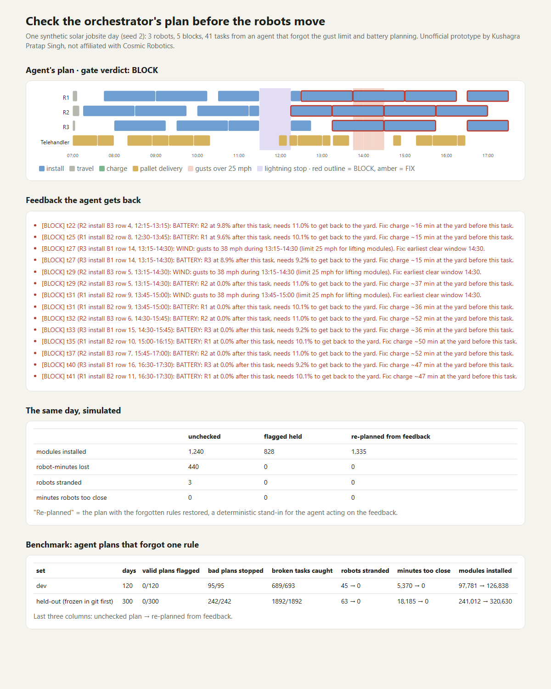

# Check the orchestrator's plan before the robots move

> Unofficial prototype by Kushagra Pratap Singh. Not affiliated with Cosmic Robotics.

## The problem

Cosmic Robotics' technology roadmap (https://www.cosmicrobotics.com/roadmap, Aug 19, 2026) says modern models "are likely already sufficient" for the AI Operator and Orchestrator layers. The remaining work is "building the harness and tooling to empower modern language models to manage physical assets", with agents deployed on **Constellation**, "our jobsite planning and mission control software … to coordinate tasks in the field." For the robot controller itself, the roadmap asks for "a white box real-time collision and safety checking system."

An LLM that plans a solar jobsite day can forget a rule. It might lift modules in 38 mph gusts, send a robot to a row whose torque tube isn't in yet, skip a charge so a 300 kW-class robot dies mid-block, or put two heavy-lift robots one row apart. This prototype is a white-box gate for the **plan**: it checks what the orchestrator emits before anything is dispatched.

## What I built

| | |
|---|---|
| `sitegate/site.py` | Synthetic jobsite day: 5 blocks × 24 tracker rows (90 modules each), torque tubes ready now / later today / not today, pallets of 31 staged per row, 15-min gust forecast with fronts, lightning, 3 battery-electric robots, 3 fastening crews (some starting with hours already worked). All limits are in one `LIMITS` dict and are **my assumptions**, not Cosmic's specs (e.g. 25 mph gust limit for lifting modules, 30/30 lightning rule, 2-row separation). |
| `sitegate/gate.py` | Checks every task of a plan (install / travel / charge / pallet delivery). **BLOCK**: wind, lightning, robot separation, battery below what's needed to get back to the yard. **FIX**: tube not ready, modules not staged, row full, rate, robot not in that block, travel too short, double-booked robot/crew/telehandler, crew hours, charging away from the yard. Each issue comes with a concrete fix the agent can re-plan from ("earliest clear window 14:30", "charge ~16 min at the yard before this task", "deliver 2 pallets to B2 row 15 before 08:00"). |
| `sitegate/planner.py` | A deterministic day planner (stand-in for the agent). `forget={...}` makes it behave like an agent that forgot one rule, and it **logs every task where forgetting actually broke something**. That log is the ground truth, computed separately from the gate. |
| `sitegate/sim.py` | Runs a plan against the day in 5-minute steps: modules installed, robot-minutes lost (weather stop, no tube, no modules, wrong place), robots stranded at 0%, minutes two robots worked too close, crew overtime. |



## Results

| set | days | valid plans flagged | bad plans stopped | broken tasks caught (right task + code) | robots stranded* | minutes robots too close* | modules installed* |
|---|---|---|---|---|---|---|---|
| dev (seeds 1–120) | 120 | 0/120 | 95/95 | 689/693 | 45 → 0 | 5,370 → 0 | 97,781 → 126,838 |
| **held-out** (300 days frozen in git first) | 300 | **0/300** | **242/242** | **1,892/1,892** | 63 → 0 | 18,185 → 0 | 241,012 → 320,630 |

\* unchecked agent plan → plan re-made with the forgotten rule restored (a deterministic stand-in for the agent acting on the gate's feedback). Simply holding back the flagged tasks also gives 0 strandings and 0 separation minutes, but installs less (see `out/eval_*.txt`).

- On dev, the 4 battery misses are borderline. The planner's own battery estimate (the truth labels) is slightly cruder than the gate's; it ignores some idle drain.
- Days where forgetting a rule changed nothing (e.g. "forgot lightning" on a day with no storm) count as "no effect", not as catches.
- Git history: `526f1e5` froze the held-out days; `eead782` is that first run, unedited.

**Limits:**
- Everything is synthetic, and the limits are my assumptions.
- The "agent" is a rule-based planner with one rule switched off, not an LLM. Real LLM plans will be messier (several mistakes at once, odd time formats), and the gate checks each task independently, so that should still work, but I haven't shown it.
- Physics is coarse: linear battery drain, constant install rate, straight-line block distances.

## Run it

```
python demo.py                # one bad day -> out/report.html
python evaluate.py heldout    # or: dev
python -m pytest -q           # 7 tests
```

Python 3.10+, standard library only (pytest for tests). Nothing touches Cosmic's systems or Constellation.
